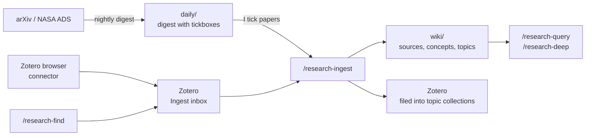

# Research wiki

A literature knowledge base that Claude maintains for me: **Zotero** holds the papers, and a git-tracked folder of Markdown notes, `~/Research`, holds what I've learned from them. That covers what each paper does and assumes, how papers relate, how ideas changed over time, and the equations needed to implement them. I read it in [Obsidian](https://obsidian.md) on the Mac, and Claude reads and writes it with plain file tools on any machine.

!!! info "Based on Florent Leclercq's setup"
    This is adapted from Florent Leclercq's **research_second_brain**, an application of the "LLM Wiki" pattern to research literature. His repo is the original and the best place to start:

    [git.aquila-consortium.org/fleclercq/research_second_brain](https://git.aquila-consortium.org/fleclercq/research_second_brain)



## How it works day to day

- **Every morning** a [nightly job](#7-the-nightly-job) on a server writes a digest of new arXiv papers, scored against my research interests: `daily/digest_<date>.md`. Each paper ends with two tickboxes, `- [ ] ingest` and `- [ ] to read`.
- **I tick papers** in Obsidian. Papers I save from the browser with the Zotero connector, or find with `/research-find`, land in Zotero's **Ingest** collection.
- **The next night** the job ingests every ticked paper and every item in Ingest. Each one gets a source page, updates to the relevant concept and topic pages, and is filed in the right Zotero collection.
- **Any time**, on any machine and from any folder, `/research-query` answers from the wiki, and `/research-deep` answers with verbatim quotes from the papers.

Papers the job can't finish on its own (an ambiguous match, a missing PDF) are marked blocked instead of guessed at. Zotero items get a `needs-kiyam` tag and a note saying why, and digest lines become `- [x] ingest — blocked: <reason>`. The job skips blocked items until I've dealt with them.

## Setup

### 1. Prerequisites

- **[Claude Code](https://docs.anthropic.com/en/docs/claude-code)**, logged in, on every machine you'll use.
- **[uv](https://docs.astral.sh/uv/)**, to install the MCP servers: `curl -LsSf https://astral.sh/uv/install.sh | sh`.
- **[Zotero](https://www.zotero.org)** desktop on your main machine, with a free zotero.org account and sync turned on. Servers reach the library through the web API instead.
- **[Obsidian](https://obsidian.md)** (optional) for reading the wiki on the Mac.
- **A private git remote** for the vault. I use my self-hosted [Forgejo](https://forgejo.org); a private GitHub repo works the same.
- **[chezmoi](../terminal/terminal-setup.md#chezmoi)** if you want the skills, scripts and secrets on several machines.

### 2. Create the vault

```bash
mkdir -p ~/Research/{daily,docs,wiki/{topics,entities,concepts,sources,syntheses,quotes}}
cd ~/Research
git init
git remote add origin <your-private-git-url>
```

The vault's `CLAUDE.md` is the most important file. It's the schema every skill reads first, and it holds every shared rule and procedure:

- the layout;
- page types and their frontmatter;
- the source-page template;
- how to write equations and links;
- the Zotero conventions;
- how to identify a paper;
- git sync;
- the digest format.

Start from Florent Leclercq's [research_second_brain](https://git.aquila-consortium.org/fleclercq/research_second_brain) and adapt it. The layout mine uses:

```text
~/Research/
  CLAUDE.md     the schema
  AGENTS.md     symlink to CLAUDE.md, for other agents
  DESIGN.md     why it's built this way
  daily/        digests; seen_papers.txt (every paper ever shown); my_papers_cache.md
  wiki/
    index.md    catalog of every page, read first for any question
    log.md      append-only history
    topics/     one hub per research topic (1:1 with a top-level Zotero collection)
    entities/   people, groups, surveys, software
    concepts/   methods, models, quantities, where the equations live
    sources/    one page per paper
    syntheses/  filed answers and literature-review notes
    quotes/     verbatim quotes backing /research-deep answers
```

The rules that matter most:

- **Raw sources are immutable.** Claude never edits, moves or deletes PDFs or Zotero attachments. Corrections go on the wiki page.
- **The pages are Claude's.** It prefers updating an existing page to creating a near-duplicate.
- **No orphans.** Every new page is linked from a topic hub or the index.
- **Say when something changes the picture.** A new paper that complicates an earlier claim gets that written down explicitly, never silently overwritten.

!!! tip "Digest tickboxes need a blank line between them"
    ```markdown
    - [ ] ingest

    - [ ] to read
    ```
    I tick a box on the Mac while the server rewrites the neighbouring line to `- [x] ingest — done 2026-10-24`. The blank line keeps those two edits from producing a git conflict.

### 3. Set up Zotero

- Create a collection called **`Ingest`**. It's the inbox: the browser connector, `/research-find` and the nightly job all use it. An item only leaves `Ingest` once its wiki pages are committed. Note the collection's key from its URL on zotero.org, because the nightly job asks the API for it directly.
- Create one top-level collection per research topic. They map 1:1 onto `wiki/topics/`.
- Create an API key at [zotero.org/settings/keys](https://www.zotero.org/settings/keys) with read/write access to your personal library. Note your **user ID**, shown on the same page.
- On the Mac, Zotero's local API lets the MCP server talk to the running app. Turn it on under *Zotero → Settings → Advanced → Allow other applications on this computer to communicate with Zotero*.

!!! warning "Servers never attach PDFs"
    If your Zotero files sync through WebDAV rather than Zotero's own storage, a PDF uploaded through the web API never reaches your file storage. So servers only create items, and I add the PDFs on the Mac afterwards with Zotero's *Find Available PDF*.

### 4. Install the MCP servers

Two MCP servers connect Claude to Zotero and to the literature:

| Server | Used for |
|---|---|
| [zotero-mcp-server](https://pypi.org/project/zotero-mcp-server/) | Search, read, create and file Zotero items, collections, notes and annotations. |
| [mcp-ads-arxiv](https://github.com/estevesjh/mcp-ads-arxiv) | NASA ADS and arXiv search, citation graphs, and paper full text. |

```bash
uv tool install zotero-mcp-server
uv tool install git+https://github.com/estevesjh/mcp-ads-arxiv
```

`mcp-ads-arxiv` needs a NASA ADS API token: log in at [ui.adsabs.harvard.edu](https://ui.adsabs.harvard.edu), then *Account → Settings → API Token*.

### 5. Keep the keys out of config files

The API keys go in one file, `~/.config/research/secrets.env`, with permissions `600`:

```sh title="~/.config/research/secrets.env"
ADS_API_TOKEN=...
ZOTERO_API_KEY=...
ZOTERO_LIBRARY_ID=...
```

Claude starts each MCP server through a small wrapper script that reads the file and exports **only that server's own key**:

=== "~/.local/bin/research-zotero-mcp"

    ```sh
    #!/bin/sh
    # Start zotero-mcp: local Zotero app on macOS, zotero.org web API elsewhere.
    if [ "$(uname)" = Darwin ]; then
        ZOTERO_LOCAL=true exec zotero-mcp "$@"
    fi
    secrets="$HOME/.config/research/secrets.env"
    [ -r "$secrets" ] || { echo "research-zotero-mcp: missing $secrets (run chezmoi apply)" >&2; exit 1; }
    . "$secrets"; export ZOTERO_API_KEY ZOTERO_LIBRARY_ID  # only this server's own keys
    export ZOTERO_LIBRARY_TYPE=user
    exec zotero-mcp "$@"
    ```

=== "~/.local/bin/research-ads-mcp"

    ```sh
    #!/bin/sh
    # Start mcp-ads-arxiv with research secrets visible to it only.
    secrets="$HOME/.config/research/secrets.env"
    [ -r "$secrets" ] || { echo "research-ads-mcp: missing $secrets (run chezmoi apply)" >&2; exit 1; }
    . "$secrets"; export ADS_API_TOKEN  # only this server's own key
    # Paper cache stays outside ~/Research: the server creates a papers/ dir in it.
    export LIT_CACHE_DIR="$HOME/.cache/mcp-ads-arxiv"
    exec mcp-ads-arxiv "$@"
    ```

Then register both at **user scope**, so they're available in every project:

```bash
chmod +x ~/.local/bin/research-*-mcp
claude mcp add -s user zotero research-zotero-mcp
claude mcp add -s user mcp-ads-arxiv research-ads-mcp
claude mcp list        # both should show ✔ Connected
```

Doing it this way means the keys are never in `~/.claude.json`, never passed with `claude mcp add -e`, and never in your shell's environment. On the Mac the Zotero wrapper uses the local app and needs no key at all.

**Sharing the secrets between machines with chezmoi.** The secrets file is in my *public* dotfiles, but encrypted with [age](https://age-encryption.org) using chezmoi's built-in encryption:

```bash
age-keygen -o ~/.config/chezmoi/key.txt     # once; copy this key to each machine by hand
```

```toml title="~/.config/chezmoi/chezmoi.toml"
encryption = "age"
[age]
    identity = "~/.config/chezmoi/key.txt"
    recipient = "age1..."                    # the public key printed by age-keygen
```

```bash
chezmoi add --encrypt ~/.config/research/secrets.env   # stored as encrypted_private_secrets.env.age
```

`chezmoi apply` decrypts it on every machine that has the key. `.chezmoiignore` limits it to the machines where I run Claude. Only put low-risk keys that you can rotate in a file like this.

### 6. Install the skills

The skills are folders in `~/.claude/skills/`, each with a `SKILL.md`. They're global, so they work from any folder, and every one of them starts by reading `~/Research/CLAUDE.md` and then acts on `~/Research`.

| Command | What it does | Model |
|---|---|---|
| `/research-find <id \| DOI \| title \| query>` | Find papers on NASA ADS / arXiv, by ID or by topic or citation graph, and add them to Zotero's Ingest collection. | default |
| `/research-ingest <key \| id \| pdf \| inbox \| daily>` | Read a paper, write its source page, update concept and topic pages, and file it in Zotero. `--one` processes only the oldest pending item, which is what the nightly job uses. | Sonnet |
| `/research-query <question>` | Answer from the wiki. Claude also picks this skill by itself when I ask about a paper or method. | default |
| `/research-deep <question>` | The same, but every claim is backed by a verbatim quote and exact location in the original paper. | default |
| `/research-save [slug]` | File the previous answer as a synthesis page. | Haiku |
| `/research-lint`, `/research-lint-links` | Health checks: contradictions, stale claims, gaps, orphan pages, missing links. | default / Haiku |
| `/research-reorganise` | Propose and apply topic merges, splits and renames across the wiki and Zotero together. | default |
| `/research-digest` | Write today's arXiv digest. Mostly run by the nightly job. | default |

Two frontmatter fields do a lot of work:

```yaml title="~/.claude/skills/research-ingest/SKILL.md (frontmatter)"
---
name: research-ingest
description: Ingest papers into Kiyam's research wiki (~/Research) and file them in Zotero. Invoked only as /research-ingest.
argument-hint: "<zotero-key | arxiv-id | DOI | pdf-path | inbox | backlog | daily> [--batch]"
disable-model-invocation: true
model: sonnet
---
```

- **`disable-model-invocation: true`** means the skill only runs when I type it, and Claude never starts an ingest or a reorganise on its own. Only `research-query` and `research-deep` leave it off, so Claude can use them whenever a question touches the literature.
- **`model:`** runs the mechanical skills on a cheaper model: Sonnet for ingest, Haiku for saving and link checks.

To install, put the skill folders in `~/.claude/skills/` and start a new Claude session. Mine live in my chezmoi dotfiles, so `chezmoi update` installs them on every machine. See [Skills](skills.md).

### 7. The nightly job

The digest and the ingest queue run every morning on a server, as a **systemd user timer**. It started as a scheduled task in the Claude desktop app on the Mac. That only ran when the laptop was awake and the app was open, so mornings after a closed lid had no digest. A server is always on.

What a run does:

1. Pull the vault.
2. **On weekdays**, write today's digest (`/research-digest`). arXiv only sends new listings Monday to Friday.
3. Ingest each **ticked paper**, then each item in the **Zotero Ingest inbox**. Each one gets its **own Claude session** (`/research-ingest daily --one`, `/research-ingest inbox --one`), so every paper starts with a fresh context. There's a cap of 40 a night.
4. Push.

**a) Give the server its own git key.** Create a deploy key that can only access the vault repo, and add it to the repo with write access:

```bash
ssh-keygen -t ed25519 -N "" -f ~/.ssh/research_deploy -C "research-nightly"
cat ~/.ssh/research_deploy.pub   # add as a deploy key with write access on the Research repo
git clone <your-private-git-url> ~/Research
```

**b) Log Claude Code in** on the server as your normal user (`claude`, then `/login`). The headless runs use that same login and plan.

**c) Install the script** as `~/.local/bin/research-digest-cron` and make it executable:

```sh title="~/.local/bin/research-digest-cron"
#!/bin/sh
# Write today's arXiv digest, then process ticked papers and the Zotero Ingest inbox,
# one per Claude session. Exit 1 = usage limit (systemd retries later);
# exit 2 = needs a human (git conflict, unpushed work, rejected key; no retry).
export PATH="$HOME/.local/bin:/usr/local/bin:/usr/bin:/bin"
export GIT_SSH_COMMAND="ssh -i $HOME/.ssh/research_deploy -o IdentitiesOnly=yes -o BatchMode=yes"
cd "$HOME/Research" || exit 2
TOOLS="Bash,Read,Write,Edit,Glob,Grep,WebFetch,mcp__zotero,mcp__mcp-ads-arxiv"
MAX_TICKS=40                             # nightly cap, ticks + inbox together
SESSION_TIMEOUT=${SESSION_TIMEOUT:-45m}  # one hung session must not eat the night
INGEST_COLLECTION=<ingest-collection-key>

run() {  # $1 = prompt
    out=$(printf '%s\n' "$1" | timeout "$SESSION_TIMEOUT" claude -p --allowedTools "$TOOLS" 2>&1); rc=$?
    printf '%s\n' "$out"
    [ "$rc" -eq 124 ] && echo "session timed out after $SESSION_TIMEOUT"
    case "$out" in *"hit your session limit"*|*"usage limit"*) echo "usage limit: will retry"; exit 1;; esac
    return $rc
}
pull() {  # commit leftovers of a killed session, pull; on failure leave the repo clean and stop
    if [ -n "$(git status --porcelain wiki daily)" ]; then
        git add -A wiki daily && git commit -qm "wip: interrupted session (lint will tidy)"
    fi
    git pull -q --rebase --autostash && return 0
    git rebase --abort 2>/dev/null
    echo "git pull failed (conflict?) - resolve in ~/Research, then: systemctl --user start research-digest"
    exit 2
}
next_tick() { grep -nE '^- \[x\] (ingest|to read)[[:space:]]*$' daily/*.md 2>/dev/null | head -1; }
zotero_ingest() {  # prints "<count> <oldest key>" for unblocked Ingest items; "-1" if unreachable
    resp=$( . "$HOME/.config/research/secrets.env"
            printf 'header = "Zotero-API-Key: %s"\n' "$ZOTERO_API_KEY" |  # key via stdin, not argv
            curl -s -i -K - "https://api.zotero.org/users/$ZOTERO_LIBRARY_ID/collections/$INGEST_COLLECTION/items/top?limit=1&format=keys&sort=dateAdded&direction=asc&tag=-needs-kiyam" ) ||
        { echo -1; return; }
    printf '%s\n' "$resp" | tr -d '\r' | awk '
        NR==1 {code=$2} /^$/ {body=1; next}
        tolower($1)=="total-results:" {n=$2}
        body && NF && !k {k=$1}
        END {if (code==401 || code==403) print "rejected"; else if (code!=200) print -1; else print (n?n:0), k}'
}

pull
[ "$(date -u +%u)" -le 5 ] && { run "/research-digest" || exit 1; }  # arXiv mails Mon-Fri only

i=0; last=""
while [ "$i" -lt "$MAX_TICKS" ]; do          # 1) ticked papers in the digests
    pull
    t=$(next_tick)
    [ -z "$t" ] && { echo "no pending ticks"; break; }
    [ "$t" = "$last" ] && { echo "tick not marked done or blocked: $t - stopping"; break; }
    last=$t
    run "/research-ingest daily --one"
    i=$((i+1))
done

last=""
while [ "$i" -lt "$MAX_TICKS" ]; do          # 2) the Zotero Ingest inbox
    set -- $(zotero_ingest)
    case "$1" in
        rejected) echo "Zotero rejected the API key"; exit 2;;
        -1) echo "Zotero unreachable - skipping the inbox tonight"; break;;
        0) echo "Ingest inbox empty"; break;;
    esac
    [ "$2" = "$last" ] && { echo "Ingest item $2 not filed or blocked - stopping"; break; }
    last=$2
    run "/research-ingest inbox --one"
    i=$((i+1))
done

pull; git push -q 2>/dev/null
if git status -sb | head -1 | grep -q ahead; then
    echo "unpushed commits left in ~/Research - check git status"; exit 2
fi
```

**d) Install the systemd units:**

=== "~/.config/systemd/user/research-digest.timer"

    ```ini
    [Unit]
    Description=Run the arXiv digest (weekdays) + ingest (daily) each morning

    [Timer]
    OnCalendar=*-*-* 03:30:00 UTC
    Persistent=true
    RandomizedDelaySec=5min

    [Install]
    WantedBy=timers.target
    ```

=== "~/.config/systemd/user/research-digest.service"

    ```ini
    [Unit]
    Description=Nightly arXiv digest + ticked-paper ingest into ~/Research
    Wants=network-online.target
    After=network-online.target
    # Retry after a usage limit (exit 1): every 75 min, at most 5 starts a day.
    StartLimitIntervalSec=24h
    StartLimitBurst=5

    [Service]
    Type=oneshot
    ExecStart=%h/.local/bin/research-digest-cron
    TimeoutStartSec=6h
    Restart=on-failure
    RestartSec=75min
    # Exit 2 = needs a human (git conflict / unpushed work): fail visibly, don't retry.
    RestartPreventExitStatus=2
    ```

```bash
loginctl enable-linger $USER                    # run user timers while logged out (may need sudo)
systemctl --user daemon-reload
systemctl --user enable --now research-digest.timer
systemctl --user start research-digest          # optional: run once now to test
```

**e) Check on it:**

```bash
systemctl --user list-timers research-digest.timer   # next and last run
systemctl --user status research-digest              # last exit status
journalctl --user -u research-digest                 # full log of each run
```

Choices in the script and units worth copying:

| What | Why |
|---|---|
| 03:30 UTC, daily | After arXiv's daily posting, and clear of the nightly [Proxmox backup](../files/backups.md#the-night). Weekends only ingest. |
| `Persistent=true` | A run missed while the server was off happens as soon as it's back. |
| Exit 1 → retry every 75 min, 5 times a day | Covers hitting a Claude usage limit: 75 minutes × 5 spans the 5-hour limit window. |
| Exit 2 → `RestartPreventExitStatus=2` | Git conflicts, unpushed work or a rejected API key need a human. The run fails visibly instead of retrying. |
| One paper per `claude -p` session | Fresh context per paper, so a long night can't run out of context. |
| `timeout 45m` per session | A hung session can't use up the whole night. |
| Leftovers committed as `wip:` | If a session is killed mid-paper, its partial edits are kept and the next pull still works. `/research-lint` tidies them. |
| Loop guards | Stop when nothing is pending, when the same tick or Ingest item comes up twice (not marked done, or blocked), or after 40. |
| `--allowedTools` | The headless session gets exactly the tools the job needs and nothing to approve. |
| Repo-only deploy key | A misbehaving run can't push anywhere but the vault. |
| API key via `curl -K -` | The Zotero key goes to curl on stdin, so it never shows in `ps`. |

### 8. Obsidian (optional)

Open `~/Research` as a vault. The [Obsidian Git](https://github.com/Vinzent03/obsidian-git) community plugin keeps it in sync with the server. Mine pulls on startup and commits and pushes every 10 minutes. Keep the vault out of iCloud, so git is the only thing syncing it.

## Using it

```text
/research-find 2401.12345                    # add one paper to Zotero's Ingest inbox
/research-find simulation-based inference weak lensing
/research-find refs 2401.12345               # its references; also cites / similar
/research-ingest 2401.12345                  # ingest one paper now, interactively
/research-ingest inbox                       # everything in Ingest
/research-query how do these papers handle intrinsic alignments?
/research-deep what exactly does the paper assume about the noise model?
/research-save                               # keep the last answer as a synthesis page
/research-lint                               # monthly health check
```

The `daily/` digests are just Markdown: tick `- [x] ingest` for papers to add to the wiki, or `- [x] to read` for ones to read. The next nightly run picks them up.
