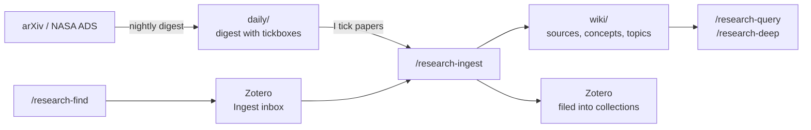

# Research wiki

A literature knowledge base that Claude maintains for me: **Zotero** holds the papers, and a git-tracked folder of Markdown notes, `~/Research`, holds what I've learned from them. That covers what each paper does and assumes, how papers relate, how ideas changed over time, and the equations needed to implement them. I read it in [Obsidian](https://obsidian.md) on the Mac, and Claude reads and writes it with plain file tools on any machine.

It's adapted from the "LLM Wiki" pattern as used in Florent Leclercq's [research_second_brain](https://git.aquila-consortium.org/fleclercq/research_second_brain).



## The vault

```text
~/Research/
  CLAUDE.md     the schema: every rule and procedure the skills share
  DESIGN.md     why it's built this way
  daily/        arXiv digests with tickboxes
  wiki/
    index.md    catalog of every page, read first for any question
    log.md      append-only history
    topics/     one hub per research topic (1:1 with a Zotero collection)
    entities/   people, groups, surveys, software
    concepts/   methods, models, quantities, where the equations live
    sources/    one page per paper
    syntheses/  filed answers and literature-review notes
    quotes/     verbatim quotes backing /research-deep answers
```

The rules that matter live in the vault's `CLAUDE.md`:

- **Raw sources are immutable.** Claude never edits, moves or deletes PDFs or Zotero attachments. Corrections go on the wiki page.
- **The pages are Claude's.** It prefers updating an existing page to creating a near-duplicate.
- **No orphans.** Every new page is linked from a topic hub or the index.
- **Say when something changes the picture.** A new paper that complicates an earlier claim gets that written down explicitly, never silently overwritten.

The vault is a git repo on my self-hosted [Forgejo](https://forgejo.org), so it's the same on every machine. Each skill pulls before it starts and pushes when it's done.

## Skills

These are global skills, so they work from any folder and always act on `~/Research`. Apart from the two question-answering ones, each has `disable-model-invocation: true`, which means it only runs when I type the command and Claude never starts one on its own. The cheaper ones also pin a smaller model in their frontmatter (`model: sonnet` / `model: haiku`).

| Command | What it does | Model |
|---|---|---|
| `/research-find <id \| DOI \| title \| query>` | Find papers on NASA ADS / arXiv, by ID or by topic or citation graph, and add them to Zotero's *Ingest* collection. | default |
| `/research-ingest <key \| id \| inbox \| daily>` | Read a paper, write its source page, update concept and topic pages, and file it in the right Zotero collection. | Sonnet |
| `/research-query <question>` | Answer from the wiki. Claude can also pick this skill itself when I ask about a paper or method. | default |
| `/research-deep <question>` | The same, but every claim is backed by a verbatim quote and exact location in the original paper. | default |
| `/research-save [slug]` | File the previous answer as a synthesis page. | Haiku |
| `/research-lint`, `/research-lint-links` | Health checks: contradictions, stale claims, gaps, orphan pages, missing links. | default / Haiku |
| `/research-reorganise` | Propose and apply topic merges, splits and renames across the wiki and Zotero together. | default |
| `/research-digest` | The daily arXiv digest, run by the [nightly routine](#nightly-routine). | default |

The skills live in my [dotfiles](../terminal/terminal-setup.md#chezmoi) with the rest of my [skills](skills.md).

## MCP servers

Two MCP servers give Claude the outside world. Both are registered at user scope (`claude mcp add -s user …`), so they're available in every project:

| Server | Used for |
|---|---|
| [zotero-mcp-server](https://pypi.org/project/zotero-mcp-server/) | Search, read, create and file Zotero items, collections, notes and annotations. |
| [mcp-ads-arxiv](https://github.com/estevesjh/mcp-ads-arxiv) | NASA ADS and arXiv search, citation graphs, and paper full text. |

Both install as `uv` tools:

```bash
uv tool install zotero-mcp-server
uv tool install git+https://github.com/estevesjh/mcp-ads-arxiv
claude mcp add -s user zotero research-zotero-mcp
claude mcp add -s user mcp-ads-arxiv research-ads-mcp
```

Each is started by a small wrapper script in `~/.local/bin` rather than directly, so API keys never go in `~/.claude.json`:

```sh title="~/.local/bin/research-zotero-mcp"
#!/bin/sh
# Start zotero-mcp: local Zotero app on macOS, zotero.org web API elsewhere.
if [ "$(uname)" = Darwin ]; then
    ZOTERO_LOCAL=true exec zotero-mcp "$@"
fi
secrets="$HOME/.config/research/secrets.env"
[ -r "$secrets" ] || { echo "research-zotero-mcp: missing $secrets (run chezmoi apply)" >&2; exit 1; }
set -a; . "$secrets"; set +a
export ZOTERO_LIBRARY_TYPE=user
exec zotero-mcp "$@"
```

- **On the Mac** it talks to the local Zotero app. **On servers** there's no Zotero app, so it uses the zotero.org web API with a key. Servers also never upload PDFs; attachments are only added from the Mac.
- **`secrets.env`** holds the ADS and Zotero API keys. It's in the public dotfiles repo, but **encrypted with [age](https://age-encryption.org)** through chezmoi's built-in encryption (`encrypted_private_secrets.env.age`). `chezmoi apply` decrypts it on each machine with a key that never leaves those machines.

## Nightly routine

Every weekday morning a routine scrapes the new arXiv listings and scores each paper against my research interests and active projects. It writes `daily/digest_<date>.md`, a list of short summaries with tickboxes. Ticking `- [x] ingest` or `- [x] to read` in Obsidian marks a paper for the wiki, and the next night's run ingests every ticked paper.

### Where it runs: a server, not the laptop

It started as a scheduled task in the Claude desktop app on the Mac. That only ran when the laptop was awake and the app was open, so mornings after a closed lid had no digest. It now runs on the workstation server as a **systemd user timer**, which is always on:

```ini title="~/.config/systemd/user/research-digest.timer"
[Unit]
Description=Run the arXiv digest on weekday mornings (after arXiv posts, clear of the 01:30 UTC Proxmox backup)

[Timer]
OnCalendar=Mon..Fri *-*-* 03:30:00 UTC
Persistent=true
RandomizedDelaySec=5min

[Install]
WantedBy=timers.target
```

```ini title="~/.config/systemd/user/research-digest.service"
[Unit]
Description=Nightly arXiv digest + ticked-paper ingest into ~/Research (pushes to Forgejo)
Wants=network-online.target
After=network-online.target
# Retry (e.g. Claude usage limit hit): every 45 min, at most 5 attempts in 6 h.
StartLimitIntervalSec=6h
StartLimitBurst=5

[Service]
Type=oneshot
ExecStart=%h/.local/bin/research-digest-cron
TimeoutStartSec=6h
Restart=on-failure
RestartSec=45min
```

- **`Persistent=true`** runs a missed timer as soon as the machine is back, for example after a reboot.
- **`Restart=on-failure` every 45 minutes** covers the most common failure, hitting a Claude usage limit. The run simply tries again once the limit resets.
- The time is after arXiv's daily posting and clear of the nightly [Proxmox backup](../files/backups.md#the-night).
- For a user timer to run while I'm logged out, the account needs lingering on: `loginctl enable-linger $USER`.
- `.chezmoiignore` only installs these units on that one server.

```bash
systemctl --user enable --now research-digest.timer
systemctl --user list-timers research-digest.timer   # next and last run
journalctl --user -u research-digest                 # logs
```

### The script

The service runs Claude Code headless (`claude -p`) with a fixed list of allowed tools. It writes the digest first, then ingests the ticked papers **one per Claude session**. Every paper starts with a fresh context, and a long night can't run one context out of space:

```sh title="~/.local/bin/research-digest-cron"
#!/bin/sh
export PATH="$HOME/.local/bin:/usr/local/bin:/usr/bin:/bin"
# Commits/pushes use a deploy key that can only access the Research repo.
export GIT_SSH_COMMAND="ssh -i $HOME/.ssh/research_deploy -o IdentitiesOnly=yes -o BatchMode=yes"
cd "$HOME/Research" || exit 1
TOOLS="Bash,Read,Write,Edit,Glob,Grep,WebFetch,mcp__zotero,mcp__mcp-ads-arxiv"
MAX_TICKS=40

run() {  # exits 1 on a usage limit so systemd retries later
    out=$(printf '%s\n' "$1" | claude -p --allowedTools "$TOOLS" 2>&1); rc=$?
    printf '%s\n' "$out"
    case "$out" in *"hit your session limit"*|*"usage limit"*) echo "usage limit: will retry"; exit 1;; esac
    return $rc
}
pending() { grep -hE '^- \[x\] (ingest|to read)[[:space:]]*$' daily/*.md 2>/dev/null | wc -l; }

run "/research-digest" || exit 1

i=0; prev=-1
while [ "$i" -lt "$MAX_TICKS" ]; do
    git pull -q --rebase --autostash
    n=$(pending)
    [ "$n" -eq 0 ] && { echo "no pending ticks"; break; }
    [ "$n" -eq "$prev" ] && { echo "a tick was not marked done; stopping to avoid a loop"; break; }
    prev=$n
    run "/research-ingest daily --one"
    i=$((i+1))
done
```

Some safety properties worth copying:

- **A deploy key, not my own.** The server pushes with an SSH key that only has write access to the Research repo. A misbehaving run can't touch anything else.
- **A fixed tool list.** `--allowedTools` gives the headless session only what the job needs, with nothing to approve interactively.
- **Loop guards.** The loop stops when nothing is pending, when a run fails to mark its tick done (so it can't spin on the same paper), and after at most 40 papers.
- **Never asks.** The digest skill tells Claude never to ask questions or wait for confirmation. If a step fails, it notes that in the digest and carries on.
