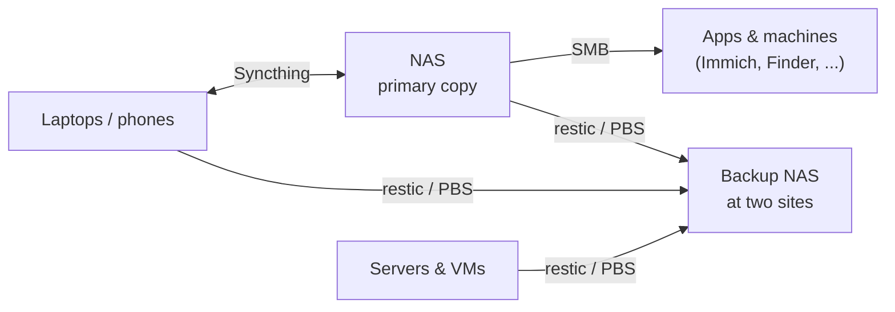

# Files

Where my files live, how they get onto devices, how other machines use them, and how they're kept safe.

| Page | Job |
|---|---|
| [File sync](sync.md) | **Syncthing** keeps the same folders on every device that needs them, with the NAS as the always-on hub. |
| [Samba](samba.md) | **SMB shares** let other machines and apps use the NAS's files without their own copy. |
| [Backups](backups.md) | **restic** for files and **Proxmox Backup Server** for VMs, aiming for two NAS boxes at two physical sites. |

Each layer does one job. Sync and shares make files *available*. Only the backups make them *safe*.
