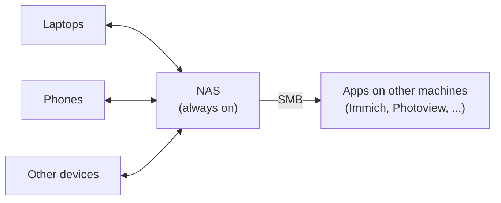

# File sync

[Syncthing](https://syncthing.net) keeps the same folders on every device that needs them. It works peer to peer, with no cloud in between, and it's open source. It's for **getting files onto devices**, not for keeping them safe: that's what [Backups](backups.md) are for.

!!! warning "Sync is not a backup"
    Delete, overwrite or encrypt a file on one device, and within seconds the change is on all of them. Syncthing's file versioning (below) gives a short-term undo. The real safety net is restic.

## How it's set up



- **The NAS is the hub.** It runs Syncthing in Docker and is always on, so devices that are rarely online at the same time still stay in sync through it. It's also the one place that has every folder, which makes it the natural thing to [back up](backups.md).
- **Folders, not whole drives.** Each folder is shared only with the devices that need it:

    | Folder | What for |
    |---|---|
    | Personal files | Documents I want on every laptop |
    | Shared family library | One library the whole family can read and add to |
    | Lightroom | Catalog and photos, so either laptop can edit |
    | Code | Projects that aren't in git, or not yet |
    | Emulator saves | Continue a game on a different device |

- **Send & receive everywhere.** Every device can change files. For a folder that should only flow one way (a phone's camera roll, say), set that device to *Send Only* and the NAS to *Receive Only*.
- **Apps read the synced folders over [SMB](samba.md).** Immich and Photoview on the Docker host mount the photo folders from the NAS rather than syncing their own copy.

## Install

=== "macOS"

    ```bash
    brew install syncthing
    brew services start syncthing   # starts at login; web UI on http://127.0.0.1:8384
    ```

=== "NAS (Docker)"

    ```yaml
    syncthing:
      image: lscr.io/linuxserver/syncthing:latest
      container_name: syncthing
      environment:
        - PUID=1000
        - PGID=1000
      volumes:
        - ./syncthing/config:/config
        - /srv/<pool>:/data          # the folders to share
      ports:
        - 8384:8384                  # web UI
        - 22000:22000/tcp            # sync protocol
        - 22000:22000/udp
        - 21027:21027/udp            # local discovery
      restart: unless-stopped
    ```

=== "Phones"

    Android: [Syncthing-Fork](https://github.com/Catfriend1/syncthing-android) from F-Droid or the Play Store. iOS: [Möbius Sync](https://www.mobiussync.com).

Pair devices by device ID in the web UI, then share a folder from one side and accept it on the other.

## Settings worth changing

- **File versioning on the NAS.** In each folder's settings on the NAS, set *File Versioning* to **Simple** or **Staggered**. Files deleted or replaced from another device are moved into `.stversions/` instead of being removed. Only the hub needs it, so laptops don't fill up with old versions.
- **`.stignore`** in a folder's root keeps junk out of the sync:

    ```text title=".stignore"
    (?d).DS_Store
    (?d)Thumbs.db
    node_modules
    .venv
    *.tmp
    ```

    The `(?d)` prefix lets Syncthing delete these files if they're the only thing stopping a folder from being removed.

- **Watch for changes** (on by default) syncs within seconds of a save. The full rescan interval can then be long, such as an hour, which keeps the disks quiet.
- **Over Tailscale**, devices find each other on the tailnet without relays. Syncthing also encrypts everything itself, so nothing else is needed.
