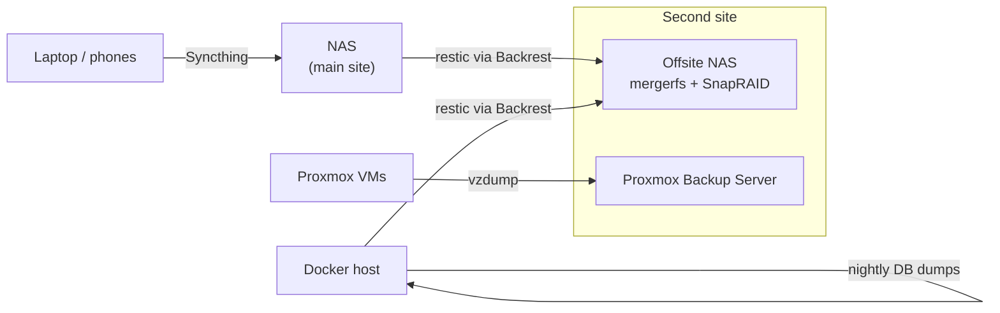

# Backups

Several layers, each covering a different failure. Everything ends up on a NAS at a **second site**, reached over [Tailscale](index.md#tailscale), so a fire, flood or burglary at home doesn't take the backups with it.

!!! warning "Three things that are not backups"
    - **Sync** (Syncthing, Dropbox). Delete or encrypt a file on one device and the deletion syncs everywhere within seconds.
    - **Parity or RAID** (SnapRAID, ZFS, mdadm). These survive a dead disk. They don't help with accidental deletion, ransomware, or the whole box dying.
    - **Snapshots on the same machine.** They're gone if the machine is.

    A backup is a separate, versioned copy you can go back in time with, ideally somewhere else. The usual rule is **3-2-1**: three copies, on two different kinds of storage, one of them offsite.

## Overview



| Layer | Tool | Protects against |
|---|---|---|
| Devices → NAS | [Syncthing](#syncthing) | A lost or broken laptop/phone. Files are already on the NAS. |
| Database dumps | [cron/systemd + `pg_dump`](#database-dumps) | A corrupted or half-written database in a file-level backup. |
| Files → offsite | [restic + Backrest](#restic-and-backrest) | Deletion, ransomware, losing the whole main site. Versioned back two years. |
| VMs → offsite | [Proxmox Backup Server](#proxmox-backups) | A VM's OS disk dying or a bad upgrade. Restore the whole VM in minutes. |
| Offsite disks | [mergerfs + SnapRAID](#snapraid-and-mergerfs) | One disk in the backup NAS dying. |

### The night

Jobs are staggered so they don't compete for disks and bandwidth:

| Time (UTC) | Job |
|---|---|
| 00:00 | Database dumps on the Docker host |
| 01:30 | Proxmox backs up all VMs to PBS |
| 02:30 | Backrest on the NAS → offsite |
| 03:30 | Backrest on the Docker host → offsite |
| 05:00 (local) | SnapRAID diff / sync / scrub on the offsite NAS |
| weekly | restic `prune` and `check` on each repo |

## Syncthing

[Syncthing](https://syncthing.net) keeps folders in sync between devices, peer to peer, with no cloud in between. It runs in Docker on the NAS and as a background service on each laptop:

```bash
brew install syncthing
brew services start syncthing   # web UI on http://127.0.0.1:8384
```

The NAS is the always-on device every laptop and phone syncs with, so it's the one place that has everything. The synced folders are then shared over SMB to other machines (Immich and Photoview read the photo folders from there), and the backup jobs pick them up from the NAS.

!!! tip "Turn on file versioning"
    In each folder's settings, enable **File Versioning** on the NAS side ("Staggered" is a good default). A file deleted or overwritten on a laptop is then moved into `.stversions/` on the NAS rather than removed. This is a short-term undo, not a substitute for the backups below.

## Database dumps

Copying a database's data directory while it's running can give you a backup that won't open. So once a night, before the file backups run, a systemd timer dumps every database to compressed SQL files with a date in the name:

```bash title="db_backup.sh (simplified)"
#!/bin/bash
BACKUPDIR=$HOME/docker/db_backups
KEEP_DAYS=2
STAMP=$(date +%Y%m%d%H%M)

# Postgres: password comes from the container's own environment
docker exec immich-postgres sh -c 'pg_dump -U "$POSTGRES_USER" "$POSTGRES_DB"' \
  | gzip > "$BACKUPDIR/immich_postgres-$STAMP.sql.gz"

# MariaDB/MySQL
docker exec mariadb sh -c 'mariadb-dump -u root -p"$MARIADB_ROOT_PASSWORD" paperless' \
  | gzip > "$BACKUPDIR/paperless_mysql-$STAMP.sql.gz"

# Keep only the last few days locally; restic keeps the history
find "$BACKUPDIR" -name '*.sql.gz' -mtime +$KEEP_DAYS -delete
```

```ini title="/etc/systemd/system/docker-db-backup.timer"
[Timer]
OnCalendar=daily
Persistent=true

[Install]
WantedBy=timers.target
```

Only two days are kept locally, because the `db_backups/` folder is included in the restic backup, which holds the long history.

!!! tip
    Read the password from the container's environment (`sh -c '... $POSTGRES_PASSWORD'`) rather than writing it into the script. Then the script contains no secrets and can live in git.

## restic and Backrest

[restic](https://restic.net) makes encrypted, deduplicated snapshots. Each run only uploads what changed, but every snapshot is a complete point-in-time copy you can browse or restore from. [Backrest](https://github.com/garethgeorge/backrest) is a web UI and scheduler on top of restic: plans, retention, a browsable snapshot list, and notifications when something fails.

Both the NAS and the Docker host run Backrest in Docker and back up to the offsite NAS over **SFTP via Tailscale**. Nothing has to be exposed to the internet, and the offsite NAS just needs an SSH account.

| | NAS | Docker host |
|---|---|---|
| Backs up | Synced files, photos (including Immich's library), Lightroom, the shared library | The whole compose repo and service data, DB dumps, books/audiobooks/music |
| Skips | — | Game libraries and other things that can be downloaded again |
| Repository | `sftp:<user>@<offsite-nas>:/srv/<pool>/<host>-backup` | same, one repo per host |
| Schedule | 02:30 daily | 03:30 daily |
| Keep | 14 daily, 8 weekly, 12 monthly, 2 yearly | same |
| Maintenance | `prune` weekly (repack when >10 % unused), `check` weekly | same |

The source directories are mounted into the Backrest container read-only:

```yaml title="compose excerpt"
  backrest:
    image: garethgeorge/backrest:latest
    volumes:
      - $DOCKERDIR/backrest/data:/data
      - $DOCKERDIR/backrest/config:/config
      - $TEMPDIR/backrest/cache:/cache      # restic cache, makes runs much faster
      - $DOCKERDIR/backrest/.ssh:/.ssh:ro   # key for the SFTP repository
      - $USERDIR/docker:/backup_data:ro
      - $MEDIADIR:/backup_media:ro
    environment:
      - BACKREST_DATA=/data
      - BACKREST_CONFIG=/config/config.json
      - XDG_CACHE_HOME=/cache
```

!!! danger "Save the repository password somewhere else"
    restic encrypts everything with the repository password. Without it the backup is unreadable, including by you. Keep it in your password manager, and **not only** on the machine being backed up.

What to leave out: anything that can be downloaded again (media from the \*arr stack, game libraries, Docker images, caches). Backing up tens of TB of replaceable media offsite costs more than it's worth. The irreplaceable things, such as photos, documents, config and databases, are a few TB.

Restoring from the command line, without Backrest:

```bash
export RESTIC_REPOSITORY=sftp:<user>@<offsite-nas>:/srv/<pool>/<host>-backup
restic snapshots                                    # list
restic ls latest /backup_data/paperless             # browse
restic restore latest --target /tmp/restore --include /backup_data/paperless
restic mount /mnt/restic                            # or browse every snapshot as a folder
```

## Proxmox backups

The hypervisor backs up every VM nightly to a [Proxmox Backup Server](https://www.proxmox.com/en/products/proxmox-backup-server/overview) (PBS) at the second site, over Tailscale. PBS deduplicates across VMs and nights, so keeping many restore points costs little space.

```text title="Datacenter → Backup job"
schedule    01:30
selection   all VMs (minus a few excluded ones)
mode        snapshot     # VM keeps running during the backup
fleecing    on           # buffer writes locally so a slow link doesn't stall the VM
compress    zstd
storage     pbs          # the remote PBS datastore
```

The data disks passed through to the VMs (the NAS's storage, the Docker host's media pool) are each marked **`backup=0`** in the VM's hardware settings, so the job only takes the OS disks. Those are what you need to get a VM booting again after a failure or a bad upgrade. The data on the other disks is covered by restic instead, file by file.

!!! tip
    Add PBS as storage with an [API token](https://pbs.proxmox.com/docs/user-management.html#api-tokens) that only has backup permissions on one datastore, rather than the root password.

## SnapRAID and mergerfs

The offsite NAS runs [OpenMediaVault](https://www.openmediavault.org) with four large disks: three for data and one for parity.

- **[mergerfs](https://github.com/trapexit/mergerfs)** pools the three data disks into one folder (`/srv/mergerfs/<pool>`). Each file lives whole on one ordinary ext4 disk, so any disk can be pulled out and read on another machine.
- **[SnapRAID](https://www.snapraid.it)** computes parity across them on a schedule. If one disk dies, its contents can be rebuilt from the others plus parity.

```text title="/etc/snapraid.conf (shape)"
parity  /srv/dev-disk-by-uuid-<parity>/snapraid.parity
content /srv/dev-disk-by-uuid-<data1>/snapraid.content
content /srv/dev-disk-by-uuid-<data2>/snapraid.content
data d1 /srv/dev-disk-by-uuid-<data1>
data d2 /srv/dev-disk-by-uuid-<data2>
data d3 /srv/dev-disk-by-uuid-<data3>
exclude lost+found/
exclude /tmp/
```

OMV's SnapRAID plugin runs a nightly script that does `diff`, then `sync`, then a `scrub` once a week that re-reads everything and checks it against parity, and emails the result. It can also refuse to sync when a run would delete or change more files than a threshold (*delete/update threshold* in the plugin, where `0` turns the check off). Setting it means a mass deletion or ransomware run doesn't get written into the parity, so the files can still be recovered from it.

Why SnapRAID rather than RAID or ZFS here:

- **Mixed disk sizes are fine.** The parity disk just has to be as big as the largest data disk.
- **Only the disk being read spins up.** Good for a box that mostly sits idle.
- **No pool to lose.** Lose more disks than you have parity and you lose only *those* disks' files, not everything.

The catch is that parity is only as fresh as the last `sync`. A disk that dies mid-afternoon loses that day's new files. That suits a backup target or a media library (written once, read many times), not a busy database.

!!! note
    The main site's own media pool is ten btrfs disks under mergerfs with **no** parity. It's all replaceable, so a dead disk means re-downloading, not losing anything. Decide per dataset whether it's worth protecting.

## Testing restores

A backup you've never restored from is a hope, not a backup. Every so often:

- restore one service's folder from restic into `/tmp` and check it opens;
- load last night's database dump into a throwaway container;
- restore a VM from PBS as a new VM ID, boot it with networking off, and then delete it.
