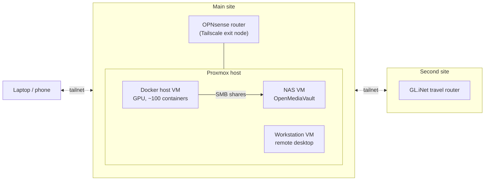

# Homelab

Notes on my homelab setup. It's spread over two sites plus a travel router, all joined by Tailscale.

- [Docker stack](docker.md): about a hundred self-hosted services on one host, behind Traefik and CrowdSec.
- [Services & monitoring](services.md): what runs and how I know it's up.
- [Backups](backups.md): Syncthing, restic/Backrest, Proxmox Backup Server and SnapRAID, with copies at a second site.

## Overview



| Machine | Runs | Role |
|---|---|---|
| Hypervisor | [Proxmox VE](https://www.proxmox.com) | Hosts the VMs below. Moving disks, snapshots and passing through the GPU all happen here. |
| Docker host | Ubuntu Server VM with an NVIDIA GPU passed through | Runs the whole [Docker stack](docker.md). The GPU is used for Immich ML, Frigate, Whisper and Ollama. |
| Workstation | Ubuntu VM | Remote desktop (xrdp) and SSH for heavier work, such as running Claude Code over [Herdr](../terminal/tmux-herdr.md#remote-machines). |
| NAS | [OpenMediaVault](https://www.openmediavault.org) VM | Shares bulk storage (photos, media, the family library) over SMB to the Docker host. |
| Router | [OPNsense](https://opnsense.org) | Firewall and router at the main site. It's also a Tailscale exit node, so I can route traffic through home when I'm on untrusted Wi-Fi. |
| Travel router | [GL.iNet](https://www.gl-inet.com) | Router at the second site, also on the tailnet. |

!!! tip "Why VMs under Proxmox"
    Each role being its own VM means I can snapshot the Docker host before a risky upgrade, rebuild the NAS without touching anything else, and move things between disks. The cost is a little overhead and passing the GPU through to one VM.

## Tailscale

Link: [tailscale.com](https://tailscale.com)

All my machines are on one [Tailscale](https://tailscale.com) network (a "tailnet"). Every machine gets a stable private IP and a MagicDNS name, and they can reach each other from anywhere without opening ports on the router or setting up a VPN server.

In practice this means `~/.ssh/config` entries simply point at the Tailscale address, and SSH, [Herdr's remote machines](../terminal/tmux-herdr.md#remote-machines) and everything else work the same at home or away:

```text title="~/.ssh/config"
Host <computer_name>
    HostName <tailscale_ip_or_magicdns_name>
```

Things worth setting up:

- **Tags for servers.** Servers are registered with a [tag](https://tailscale.com/kb/1068/tags) rather than my user account, so their node keys don't expire with my login, and ACLs can target all servers at once.
- **Exit node.** The router advertises itself as an exit node. On a phone or laptop, `tailscale set --exit-node=<router>` sends all traffic through home.
- **Routers on the tailnet.** With the routers themselves on the tailnet, both sites stay reachable, and a router can [advertise its LAN as a subnet route](https://tailscale.com/kb/1019/subnets) for devices that can't run Tailscale.
- **The reverse proxy over Tailscale.** Traefik on the Docker host also routes a few services that live on *other* machines, reaching them by their Tailscale address. See [Docker stack](docker.md#routes-to-things-outside-docker).
