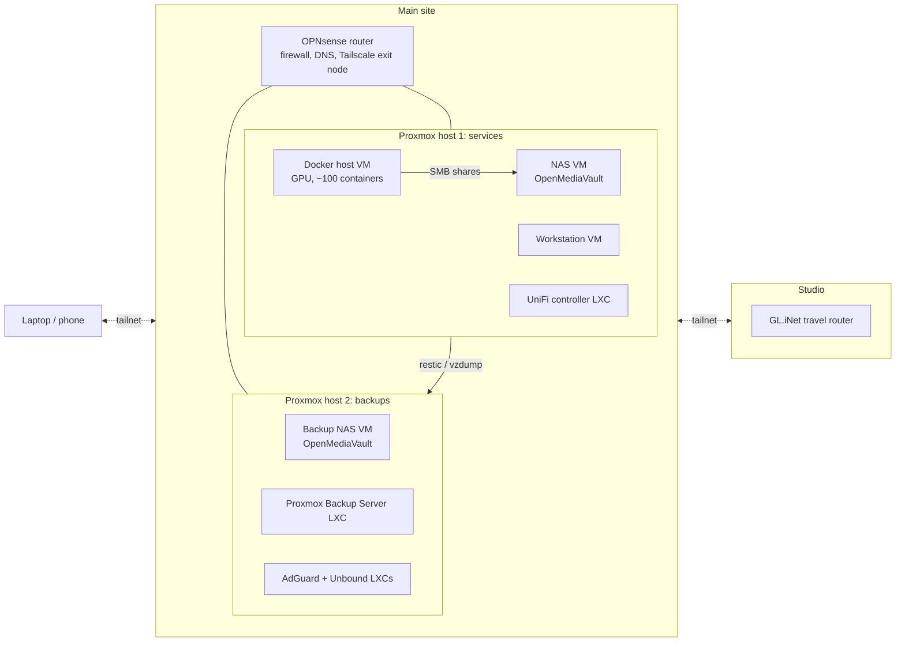

# Homelab

Notes on my homelab setup. Almost everything is at one main site, on two Proxmox hosts behind an OPNsense router. A travel router at a second location joins it over Tailscale.

- [Proxmox](proxmox.md): the hypervisor, VMs vs LXCs, GPU and disk passthrough.
- [Network](network.md): OPNsense, AdGuard Home DNS synced across sites, UniFi, and a GL.iNet travel router.
- [Docker stack](docker.md): about a hundred self-hosted services on one host, behind Traefik and CrowdSec.
- [Services & monitoring](services.md): what runs and how I know it's up.
- [Notifications](notifications.md): everything ends up as a push from a self-hosted ntfy.
- Backups, file sync and SMB shares are in their own section: [Files](../files/index.md).

## Overview



| Machine | Runs | Role |
|---|---|---|
| Router | [OPNsense](https://opnsense.org) | Firewall, router and DNS for the main site, and a Tailscale exit node. See [Network](network.md). |
| Proxmox host 1 | [Proxmox VE](https://www.proxmox.com) | The services: the Docker host, the workstation, the NAS and the UniFi controller. See [Proxmox](proxmox.md). |
| Docker host | Ubuntu Server VM with an NVIDIA GPU passed through | Runs the whole [Docker stack](docker.md). The GPU is used for Immich ML, Frigate, Whisper and Ollama. |
| Workstation | Ubuntu VM | Remote desktop (xrdp) and SSH for heavier work, such as running Claude Code over [Herdr](../terminal/tmux-herdr.md#remote-machines). |
| NAS | [OpenMediaVault](https://www.openmediavault.org) VM | The primary copy of photos, files and the family library. Shared over [SMB](../files/samba.md) and synced to devices with [Syncthing](../files/sync.md). |
| Proxmox host 2 | Proxmox VE | Separate hardware just for [backups](../files/backups.md): a backup NAS VM and Proxmox Backup Server. It also runs a second AdGuard Home and Unbound, so DNS survives the router being down. |
| Travel router | [GL.iNet](https://www.gl-inet.com) | Router at the studio, also on the tailnet. |

!!! tip "Why VMs under Proxmox"
    Each role being its own VM means I can snapshot the Docker host before a risky upgrade, rebuild the NAS without touching anything else, and move things between disks. The cost is a little overhead and passing the GPU through to one VM.

## Tailscale

Link: [tailscale.com](https://tailscale.com)

All my machines are on one [Tailscale](https://tailscale.com) network (a "tailnet"). Every machine gets a stable private IP and a MagicDNS name, and they can reach each other from anywhere without opening ports on the router or setting up a VPN server.

In practice this means `~/.ssh/config` entries simply point at the Tailscale address, and SSH, [Herdr's remote machines](../terminal/tmux-herdr.md#remote-machines) and everything else work the same at home or away:

```text title="~/.ssh/config"
Host <computer_name>
    HostName <tailscale_ip_or_magicdns_name>
```

Things worth setting up:

- **Tags for servers.** Servers are registered with a [tag](https://tailscale.com/kb/1068/tags) rather than my user account, so their node keys don't expire with my login, and ACLs can target all servers at once.
- **Exit node.** The OPNsense router advertises itself as an exit node. On a phone or laptop, `tailscale set --exit-node=<router>` sends all traffic through it.
- **Routers on the tailnet.** With the routers themselves on the tailnet, both the main site and the studio stay reachable, and a router can [advertise its LAN as a subnet route](https://tailscale.com/kb/1019/subnets) for devices that can't run Tailscale.
- **The reverse proxy over Tailscale.** Traefik on the Docker host also routes a few services that live on *other* machines, reaching them by their Tailscale address. See [Docker stack](docker.md#routes-to-things-outside-docker).
