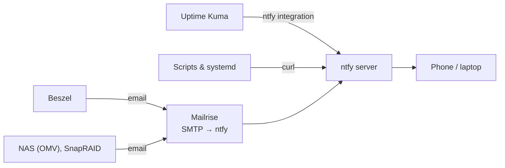

# Notifications

Everything that needs to tell me something sends it to one place: a self-hosted **[ntfy](https://ntfy.sh)** server, which pushes it to the ntfy app on my phone and laptop. Whatever a tool supports (a webhook, an ntfy integration, or only email), there's a way to get it into ntfy.



## ntfy

ntfy is a publish/subscribe push service. You send an HTTP POST to a *topic*, and every device subscribed to that topic gets a notification. I run my own server behind [Traefik](docker.md#traefik) rather than using the public `ntfy.sh`, with these settings:

```yaml title="compose excerpt"
  ntfy:
    image: binwiederhier/ntfy
    command: serve
    environment:
      - NTFY_BASE_URL=https://ntfy.<domain>
      - NTFY_UPSTREAM_BASE_URL=https://ntfy.sh   # needed for instant iOS push
      - NTFY_AUTH_FILE=/var/lib/ntfy/auth.db
      - NTFY_AUTH_DEFAULT_ACCESS=deny-all         # nothing is public
      - NTFY_ENABLE_LOGIN=true
      - NTFY_BEHIND_PROXY=true
      - NTFY_CACHE_FILE=/var/lib/ntfy/cache.db
      - NTFY_ATTACHMENT_CACHE_DIR=/var/lib/ntfy/attachments
    volumes:
      - $DOCKERDIR/ntfy:/var/lib/ntfy
```

- **`deny-all`**: by default nobody can read or write any topic. Add a user and an access token for each sender with `ntfy user add` and `ntfy token add`.
- **`NTFY_UPSTREAM_BASE_URL`**: iOS only allows Apple's push service, so a self-hosted server sends a tiny "poll now" message via `ntfy.sh`. The notification content itself never leaves your server.

Sending from anywhere is one `curl`:

```bash
curl -H "Authorization: Bearer $NTFY_TOKEN" \
     -H "Title: Backup failed" -H "Priority: high" -H "Tags: warning" \
     -d "restic exited with code 3" \
     https://ntfy.<domain>/homelab
```

One topic per area (`homelab`, `backups`, `network`) lets the phone use a different sound or mute setting for each.

## Mailrise: for things that only send email

Older software, appliances and NAS firmware can usually only send alerts by email. [Mailrise](https://github.com/YoRyan/mailrise) is a small SMTP server that turns each incoming email into an [Apprise](https://github.com/caronc/apprise) notification, ntfy included. The recipient address decides where it goes:

```yaml title="mailrise.conf"
configs:
  "nas*@mailrise.<domain>":
    urls:
      - "ntfys://<token>@ntfy.<domain>/nas"
  "snapraid*@mailrise.<domain>":
    urls:
      - "ntfys://<token>@ntfy.<domain>/backups"
  "beszel*@mailrise.<domain>":
    urls:
      - "ntfys://<token>@ntfy.<domain>/monitoring"

smtp:
  auth:
    basic:
      <user>: <password>
```

On each OpenMediaVault NAS, *System → Notification* points at Mailrise as the SMTP relay. That covers OMV's own alerts (disk SMART warnings, filesystem full) as well as the nightly SnapRAID report. On the command line it amounts to a Postfix relay:

```text title="/etc/postfix/main.cf (what OMV writes)"
relayhost = [mailrise.<domain>]:465
smtp_tls_security_level = encrypt
```

## What sends what

| Source | How | Alerts on |
|---|---|---|
| [Uptime Kuma](https://uptime.kuma.pet) | Built-in ntfy notification | Any of ~50 monitored URLs going down, and coming back up |
| [Beszel](https://beszel.dev) | Email via Mailrise | CPU, memory, disk or temperature thresholds on any server, or an agent going offline |
| NAS (OMV) | Email via Mailrise | SMART warnings, filesystem usage, service failures |
| SnapRAID | Email via Mailrise | Each nightly sync/scrub report |
| Backrest | Built-in hooks per plan (Shoutrrr, so ntfy works) | A backup or check failing. Worth turning on. |
| Scripts | `curl` | Whatever they need to |

## systemd: get told when a timer job fails

Worth adding for jobs run by systemd timers, such as the [database dumps](../files/backups.md#database-dumps), a template unit sends a notification whenever *any* unit that references it fails:

```ini title="/etc/systemd/system/notify-failure@.service"
[Unit]
Description=Send ntfy alert for %i

[Service]
Type=oneshot
EnvironmentFile=/etc/ntfy.env
ExecStart=/bin/sh -c 'curl -s -H "Authorization: Bearer $NTFY_TOKEN" -H "Title: %i failed" -H "Priority: high" \
  -d "$(journalctl -u %i -n 20 --no-pager)" https://ntfy.<domain>/homelab'
```

```ini title="docker-db-backup.service (excerpt)"
[Unit]
OnFailure=notify-failure@%n.service
```

`%n` passes the failing unit's name to the template. The notification then includes the last 20 lines of that unit's log, so you can often see what went wrong straight from the phone.
