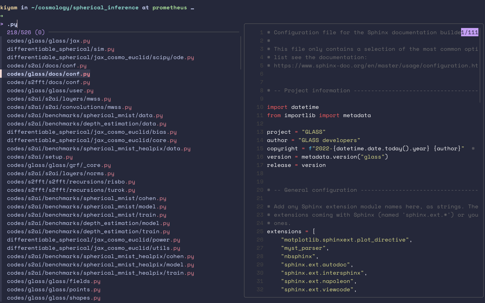

# Terminal setup

Bare terminal can be quite challenging to navigate, but there are a bunch of nice to haves that can make it both more aesthetic, but also more efficient.

We’re not going to cover things like tmux (Herdr, the new kid in town) or oh-my-zsh as those are so ubiquitous. I (Kiyam) typically manage my dotfiles with `chezmoi` which is covered later on, but if you don’t want to read all of the below feel free to just look at my dotfiles repo: [Kiyam/dotfiles](https://github.com/Kiyam/dotfiles)

## Must have tools

- `zoxide` - a replacement for the `cd` command

    Link: [github.com/ajeetdsouza/zoxide](https://github.com/ajeetdsouza/zoxide)

    It can be rebound to replace the `cd` command, but by default it binds itself to `z` . Its main uses are being able to remember paths of folders you have previously cd’ed to. So for example on hypatia for the user klin, as they often visit /share/rcif2/klin/kids_legacy/sim_output, instead of typing cd that full path, they can just type `cd sim_output` and it will take them directly to the most visited path instead. This is the main use case.

- `eza` - a replacement for `ls` with colours and highlighting.

    Link: [github.com/eza-community/eza/tree/main](https://github.com/eza-community/eza/tree/main)

    One can alias it to ls so you don’t have to get used to typing eza instead of ls and setup with some default options. So in a .zshrc file one can put

    ```bash
    alias ls="eza --color=always --long --group --git --icons=always"
    ```

- `bat` - a replacement for `cat` so you can browse text files in terminal with syntax highlighting without having to open the file with vim or emacs or something.

    Link: [github.com/sharkdp/bat](https://github.com/sharkdp/bat)

    It will also let you scroll through the text file with vim keybinds, so press j to scroll down, k to scroll up etc.

    The real power however comes when you combine this with `fd` and `fzf` .

- `fd` - an alternative to the `find` command. It’s like find, but better basically.

    Link: [github.com/sharkdp/fd](https://github.com/sharkdp/fd)

- `fzf` - a great terminal fuzzy finder utility. It lets you basically fuzzy search for files.

    Link: [github.com/junegunn/fzf](https://github.com/junegunn/fzf)

    One can use this tool simply by typing `fzf` in the terminal after installation. But a better way would be to use the `control + T` hook or `alt + c` which for GB mac users is the same for fzf as pressing `esc + c` . Now, we really should set this up to also make use of `bat` and `eza`which would allow us to scroll through our files like in the screenshot below.

    

    To setup this up, in either your .bashrc or .zshrc file, just add the following:

    ```bash
    # -- Use fd instead of fzf --
    export FZF_DEFAULT_OPTS=" \
    --color=bg+:#363a4f,bg:#24273a,spinner:#f4dbd6,hl:#ed8796 \
    --color=fg:#cad3f5,header:#ed8796,info:#c6a0f6,pointer:#f4dbd6 \
    --color=marker:#f4dbd6,fg+:#cad3f5,prompt:#c6a0f6,hl+:#ed8796"
    export FZF_DEFAULT_COMMAND="fd --hidden --strip-cwd-prefix --exclude .git"
    export FZF_CTRL_T_COMMAND="$FZF_DEFAULT_COMMAND"
    export FZF_ALT_C_COMMAND="fd --type=d --hidden --strip-cwd-prefix --exclude .git"

    # Use fd (https://github.com/sharkdp/fd) for listing path candidates.
    # - The first argument to the function ($1) is the base path to start traversal
    # - See the source code (completion.{bash,zsh}) for the details.
    _fzf_compgen_path() {
      fd --hidden --exclude .git . "$1"
    }

    # Use fd to generate the list for directory completion
    _fzf_compgen_dir() {
      fd --type=d --hidden --exclude .git . "$1"
    }

    # fzf options to make use of bat previews
    export FZF_CTRL_T_OPTS="--preview 'bat -n --color=always --line-range :500 {}'"
    export FZF_ALT_C_OPTS="--preview 'eza --tree --color=always {} | head -200'"

    # Advanced customization of fzf options via _fzf_comprun function
    # - The first argument to the function is the name of the command.
    # - You should make sure to pass the rest of the arguments to fzf.
    _fzf_comprun() {
      local command=$1
      shift

      case "$command" in
        cd)           fzf --preview 'eza --tree --color=always {} | head -200' "$@" ;;
        export|unset) fzf --preview "eval 'echo $'{}"         "$@" ;;
        ssh)          fzf --preview 'dig {}'                   "$@" ;;
        *)            fzf --preview "bat -n --color=always --line-range :500 {}" "$@" ;;
      esac
    }

    ```

    Notice at the end there’s that segment about `_fzf_comprun()` . That basically gets `fzf` and a few other tools to kick in when using tab completion. The stuff at the start about colour is just for the catppuccin colour scheme.

- `Atuin` - scrollable, searchable shell history. Honestly, this is thing is a game changer…

    Link: [github.com/atuinsh/atuin](https://github.com/atuinsh/atuin)

    

    By pressing the up arrow, one gets presented with a searchable list of my shell history. The gif from their github repo is what’s pasted up above.

- `Chezmoi` - Now all of this is a lot to manage, especially as each tool has a thing to go into your .zshrc files etc. So a great way to manage these config files that live in your home directory of `~/` is to manage them with a tool like `chezmoi` . There are a few other tools that accomplish something similar, but I like `chezmoi` due to its ability to handle machine to machine differences. You can configure it write different config files to different types of machines. Like on a mac we have homebrew, so things can be located with brew, whereas on a regular linux machine one would need different options. Then on a cluster where one doesn’t have root access, a lot of software might get installed to ~/.local/usr/bin instead. Those differences can all be handled by chezmoi.

    Link: [www.chezmoi.io](https://www.chezmoi.io/)

    Another note, for config files, like a .zshrc file, typically this would live in `~/.zshrc` , but, thanks to the whole `$XDG_CONFIG_HOME` convention, which typically points to `~/.config/` , we can store files in a .config folder instead making the home folder `~/`  much neater. So a .zshrc file could live instead at `~/.config/zsh/.zshrc` . Tmux however is a bit odd in that it needs `~/.config/tmux/tmux.conf` without the usual dot in front of the tmux.conf file.

    As a headstart, this is my dotfiles repo, and you can see how some templating has been handled for use across hypatia and a few other linux machines/mac etc: [Kiyam/dotfiles](https://github.com/Kiyam/dotfiles)
